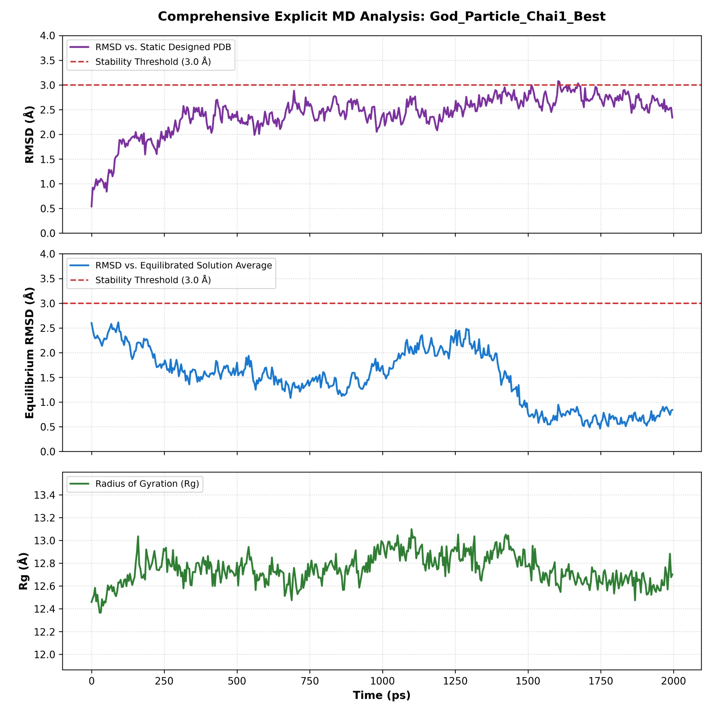

# HIV gp120 Miniprotein Binder Design

Computational design of a miniprotein binder targeting the CD4-binding site of the HIV-1 envelope glycoprotein (gp120), combining generative structure design, sequence design, structural validation, and molecular dynamics refinement.

## Approach

**1. Target preparation**
The HIV-1 envelope trimer structure (PDB [6V8X](https://www.rcsb.org/structure/6V8X)) was downloaded and processed: the asymmetric protomer chain was isolated, cleaned and repaired (missing atoms/residues, protonation), and CD4-binding-site hotspot residues were mapped onto the cleaned structure to define the design target.

**2. Parallel design generation**
Two independent binder-design strategies were run against the same hotspot target:
- **Rosetta**-based design
- **RFdiffusion**-based backbone generation with ProteinMPNN sequence design

Many candidate designs were generated across both approaches.

**3. Structural validation and comparison**
All candidates were folded with AlphaFold2 and scored (confidence/interface metrics) to compare the two design strategies head-to-head and select the strongest candidates for further refinement.

**4. Iterative refinement with Proteus**
The top candidates were carried forward into an iterative refinement loop using **Proteus**, our tool for automating the generate-check-refine cycle: candidate variants were generated across several design strategies, each checked with a short molecular dynamics stability run, and only designs passing the stability check were advanced to the next round of modification. This loop was repeated across multiple strategies until convergence on a final design.

**5. Final design: a bispecific HIV engager**
The refinement loop converged on a bispecific miniprotein design (`Strategy_E_Bispecific_Engager`, internally also referenced as `God_Particle_Chai1_Best`): one arm binds the HIV gp120 CD4-binding site, while the second arm is designed to engage immune cells, aiming to physically bridge the virus and the immune system.

**6. Final validation**
The final design was carried through a physiological, fully explicit-solvent MD simulation (TIP3P water, 0.15 M NaCl, PME electrostatics, NPT at 310.15 K, 2 fs Langevin integration — see `src/explicit_md_refinement.py`) to confirm structural stability over time. The simulation itself was run with explicit water and ions, as shown in the MD code; for the video in this repo, water and ions were removed purely for clearer visualization of the protein's motion and the binding interface — the underlying simulation was solvated throughout.

## Next steps

This design is an early-stage computational result, not a validated therapeutic candidate. Planned follow-up work includes:
- **Binding orientation checks** — confirming both arms of the bispecific engager are correctly oriented and can bind simultaneously (HIV gp120 on one arm, immune cell engagement on the other) without steric interference between the two.
- **Immunogenicity assessment** — evaluating whether the design itself would trigger an unwanted immune response.
- **Biocompatibility / blood-reaction screening** — assessing behavior in physiological blood conditions before any further development.

## Results

**RFdiffusion vs. Rosetta comparison** — `results/Figure_4A_ViolinPlot.png`, `results/Figure_4B_BarChart.png`

**Final design MD stability** — over the 2 ns production run, both the RMSD against the static designed structure and the RMSD against the equilibrated solution average stayed at or below the 3.0 Å stability threshold, with the radius of gyration holding steady (~12.4–13.1 Å) throughout:



## What's in this repo

```
src/            Core scripts: target download/prep, chain isolation, cleaning,
                hotspot mapping, and the explicit-solvent MD refinement/validation loop
results/        Comparison figures (RFdiffusion vs Rosetta), MD stability plot,
                and the final designed structure (PDB)
media/          2 ns MD trajectory video of the final design (water/ions hidden)
docs/           Methods notes
```

## What's not included

This repo shows the pipeline and the final result, not every intermediate artifact. Left out intentionally:
- The full set of trial designs and rejected candidates from both design arms
- Intermediate scoring data and logs
- Proteus source code (internal tooling used for the refinement loop above)

## Final design

The final structure (`results/final_design.pdb`) remained stable over a 2 ns explicit-solvent MD run — see `media/md_2ns_run.mp4` for the trajectory and the plot above for the stability metrics.

## Requirements

- Python 3.9+
- BioPython, PDBFixer/OpenMM (target prep)
- AlphaFold2 (structural validation)
- AutoDock Vina / OpenMM (docking and MD, not included here)
